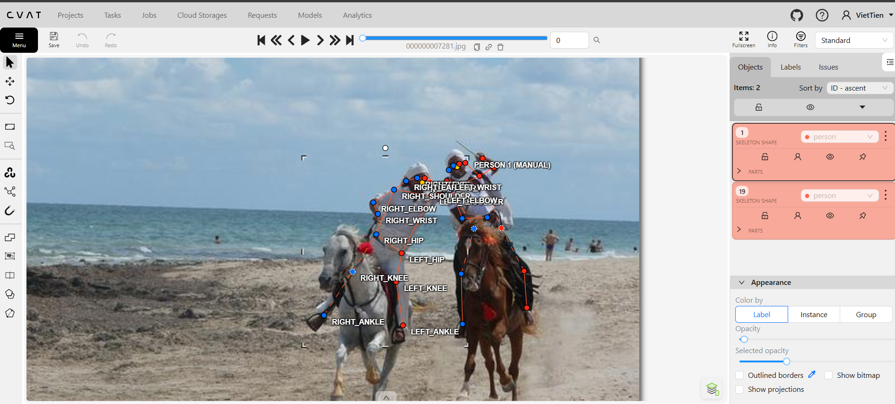
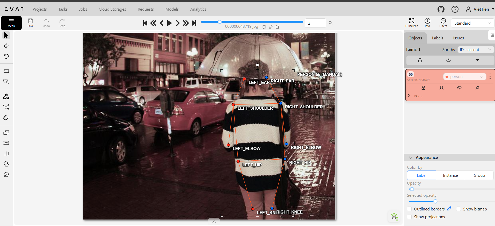
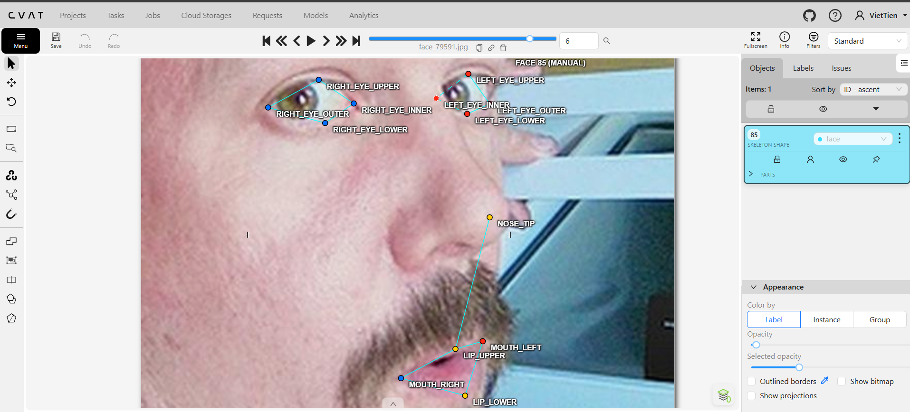
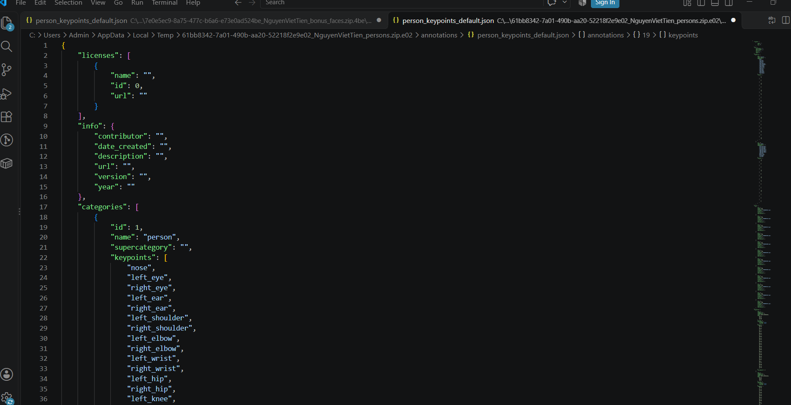

# Báo cáo cá nhân — HoVaTen-MSSV

Đổi tên file theo quy tắc `2A202603140_NguyenVietTien.md`. Ví dụ: `20241234_NguyenVanAn.md`.

Dữ liệu: 12 ảnh người COCO val2017 (Lin et al., 2014) và 8 ảnh chân dung Wikimedia Commons, chỉ dùng trong lớp.

## 0. Thông tin học viên

- Họ tên: Nguyễn Viết Tiến
- MSSV: 03140
- Email: nguyenviettien161204@gmail.com
- Link repository:https://github.com/viettien161204/K5-L2-DAY04-NguyenVietTien-03140-KeypointPose
- Phiên bản CVAT (Help → About): v2.74.1
- Máy: hệ điều hành window · RAM 16 GB · chạy CVAT chế độ đầy đủ / lite
- Bộ ảnh (`src/exports/assignment.json` do `lab.py setup` tạo): có 
- Giờ bắt đầu: 17:00 
- Giờ kết thúc: 20:00

## 1. Kiểm tra label (CP0)

| Label | Kiểu | Số điểm | Tên điểm đúng bảng của lab? | Đúng thứ tự? | Số cạnh |
|---|------|---:|---|---|--------:|
| `person` |  Skeleton  |17 | person| Có|      19 |
| `face` |     Skeleton | 13| face|Có |      15 |

Mẫu `person` dựng theo người quay mặt về camera (các điểm `left_*` nằm bên phải khung mẫu)? Có 

Cách đổi cờ `occluded` / `outside` cho **một điểm** trên phiên bản CVAT này (một câu):

chỉ cần nhấp chuột phải trực tiếp vào điểm đó trên ảnh (hoặc mở rộng danh sách điểm của Skeleton ở thanh Objects bên phải) rồi bật/tắt tùy chọn Occluded (cũng có thể di chuột vào điểm và nhấn phím Q) và Outside, khi đó viền/màu của điểm sẽ đổi trạng thái (hoặc ẩn khỏi khung hình nếu bật Outside) để xác nhận đã cập nhật.

## 2. Số lượng đã gán và thời gian (CP1, CP2)

| Nhóm ảnh | Số ảnh | Số skeleton đã gán | Số người dưới 60 px (không gán) | Số poster / gương / màn hình bỏ qua | Thời gian (phút) |
|---|---:|-------------------:|--------------------------------:|------------------------------------:|-----------------:|
| `easy` | 5 |                  7 |                               0 |                                   0 |               30 |
| `occluded` | 3 |                  3 |                               5 |                                   0 |               25 |
| `back` | 2 |                  3 |                               0 |                                   0 |               18 |
| `small` | 1 |                  1 |                               1 |                                   0 |                9 |
| `crowd` | 1 |                  4 |                               1 |                                   0 |               18 |
| `faces` | 8 |                  8 |                               — |                                   0 |               30 |

- Số ảnh người đã xong ở mốc phút 105: 10 / 10
- Thời gian thực tế (phút): CP1 100 · CP2 30 · CP3 30
- Ảnh tốn thời gian nhất là ảnh nào, vì sao?

Tốn nhất là 000000130816.jpg, vì phải vẽ skelenton 4 người, 2 gần 2 xa, 2 đối tượng gần còn chèn lên nhau

## 3. Bảng ca khó (CP1, CP2)

Mỗi điểm bạn phân vân một dòng, nhất là phân vân giữa `v = 1` và `v = 0`, hoặc không chắc hướng người.

| Ảnh | Người / mặt | Điểm | Cờ đã chọn | Phân vân giữa | Lý do chọn |
|---|---|---|---:|---------------|------------|
| `000000130816.jpg` | Person #2 (người bị chèn phía sau) | `left_hip` | `v = 1` | `v = 1`, `v = 0` | Bị người đứng trước che phần hông và đùi, nhưng vẫn thấy rõ hướng thân trên và cổ chân nên ước lượng được vị trí khớp giải phẫu đáng tin cậy. |
| `000000188804.jpg` | Person #1 | `right_ankle` | `v = 0` | `v = 1`, `v = 0` | Bàn chân và mắt cá nằm sát mép dưới khung hình và bị vật cản che hoàn toàn, không đủ cơ sở xác định tâm khớp nên đặt `outside` (`v = 0`) tránh làm nhiễu OKS. |
| `face_294580.jpg` | Face #1 | `left_eye_outer` | `v = 0` | `v = 1`, `v = 0` | Góc mặt nghiêng lớn khiến sống mũi và lọn tóc che khuất hoàn toàn đuôi mắt trái, không đủ cơ sở ước lượng chính xác mép mí nên chọn `v = 0`. |
| `face_294580.jpg` | Face #1 | `left_eye_inner` | `v = 0` | `v = 1`, `v = 0` | Khóe mắt trong bên trái bị sống mũi che khuất hoàn toàn ở góc nghiêng, không xác định được điểm giao mí nên đặt `outside` (`v = 0`). |

## 4. Bảng tự review (CP3)

Đi từ ảnh cuối về ảnh đầu. 5 ảnh người (ít nhất 2 ảnh `back` hoặc `crowd`) và 3 ảnh mặt. Ít nhất 8 dòng, kể cả dòng `ok`. Ghi lỗi trước, sửa sau.

Mã lỗi dùng đúng một trong: `lr_swap`, `vis_flag`, `position`, `missing`, `extra`, `ok`.

| Ảnh | Người / mặt | Điểm | Mã lỗi | Ghi chú | Đã sửa? |
|---|---|---|---|---|---|
| `000000493741.jpg` | Person #1 (`back`) | `left_shoulder`, `right_shoulder` | `lr_swap` | Người quay lưng nhưng quên đảo trục trái/phải theo mẫu mặc định (để `left_*` bên phải ảnh). Đã hoán đổi lại toàn bộ cặp vai–tay–hông–chân. | Có |
| `000000391222.jpg` | Person #1 (`back`) | Toàn bộ 17 điểm | `ok` | Đúng hướng quay lưng, đường nối không bắt chéo, các điểm đặt đúng tâm khớp. | — |
| `000000324953.jpg` | Person #2 (`occluded`) | `left_wrist` | `vis_flag` | Cổ tay bị khuất sau thân người nhưng đang để mặc định `v = 2` (visible); đã chuyển sang `occluded` (`v = 1`). | Có |
| `000000130816.jpg` | Person #1–4 (`crowd`) | Toàn bộ các điểm | `ok` | Đủ 4 skeleton cho 4 người ≥ 60 px, tách bạch đúng người gần và người xa, không gán nhầm người < 60 px. | — |
| `000000007281.jpg` | Person #1, #2 (`easy`) | Toàn bộ các điểm | `ok` | Khung xương cân đối, tọa độ khớp chuẩn, cờ `v = 2` chính xác. | — |
| `face_92028.jpg` | Face #1 | `left_eye_upper`, `left_eye_lower` | `position` | Điểm mí trên đặt hơi cao chạm hàng lông mi; đã phóng to và kéo lại sát mép mí ngay trên tâm con ngươi. | Có |
| `face_559185.jpg` | Face #1 | Toàn bộ 13 điểm | `ok` | Đúng quy tắc mắt trái nằm bên phải ảnh (mặt thẳng), khóe mắt và khóe miệng khớp mép. | — |
| `face_294580.jpg` | Face #1 | Toàn bộ 13 điểm | `ok` | Các điểm bị che khuất đã đặt đúng cờ `v = 0` / `v = 1`, không đặt điểm bừa ra mép mặt. | — |

Tổng hợp số lỗi theo mã:

| `lr_swap` | `vis_flag` | `position` | `missing` | `extra` | `ok` |
|---:|---:|---:|---:|---:|---:|
| 1 | 1 | 1 | 0 | 0 | 5 |

Điểm còn phân vân giữa `v = 1` và `v = 0` (ghi cả hai lựa chọn và lý do chọn):

Ở ảnh `000000130816.jpg` (Person #2), điểm `left_hip` bị người đứng trước che khuất: nếu chọn `v = 0` (`outside`) thì an toàn tuyệt đối vì không thấy trực tiếp vùng hông; tuy nhiên tôi chọn `v = 1` (`occluded`) vì phần thân trên và chân trái phía dưới đều lộ rõ theo trục cơ thể tự nhiên, giúp ước lượng tâm khớp hông với sai số nhỏ và giữ lại dữ liệu học hữu ích cho mô hình.

## 5. Kiểm file xuất và kết quả tự kiểm (CP4)

Tự kiểm tay trong file JSON:

| File | Người / mặt kiểm (ảnh, thứ tự) | Số phần tử `keypoints` | Điểm `outside` ra `v = 0`, `occluded` ra `v = 1`? | `num_keypoints` khớp? |
|---|---|---:|---|---|
| `NguyenVietTien_persons.zip` | `000000130816.jpg`, Person #2 | 51 | Có (`left_hip` ra `v = 1`) | Có (khớp số điểm `v > 0`) |
| `NguyenVietTien_persons.zip` | `000000188804.jpg`, Person #1 | 51 | Có (`right_ankle` ra `v = 0`) | Có (khớp số điểm `v > 0`) |
| `NguyenVietTien_faces.zip` | `face_294580.jpg`, Face #1 | 39 | Có (`left_eye_outer`, `left_eye_inner` ra `v = 0`) | Có (khớp số điểm `v > 0`) |

Sau khi xuất, CVAT ghi `occluded` thành `v = 1` và `outside` thành `v = 0`. Tọa độ của điểm `outside` trong file là `0, 0` hay tọa độ cũ? **Tọa độ cũ** *(CVAT 2.x giữ nguyên tọa độ điểm thay vì ghi `0, 0` như chuẩn COCO gốc)*.

Hai job đã chuyển sang completed trên CVAT? **Có**

Dán phần **TÓM TẮT** in ra từ `src/check_submission.py`:

```text
- File person: NguyenVietTien_persons.zip
  Số ảnh: 12 · số skeleton `person`: 20 · mỗi annotation 51 số
  Skeleton theo ảnh: 000000007281=2, 000000021235=1, 000000043719=1, 000000130816=4, 000000188804=2, 000000189365=2, 000000194027=1, 000000205650=1, 000000324953=2, 000000391222=2, 000000445187=1, 000000493741=1
  Cờ v: v=2 221 (65%) · v=1 31 (9%) · v=0 88 (26%)
  num_keypoints trung bình: 12.6
- File face: NguyenVietTien_faces.zip
  Số ảnh: 8 · số skeleton `face`: 8 · mỗi annotation 39 số
  Skeleton theo ảnh: face_175798=1, face_264124=1, face_294580=1, face_362568=1, face_504911=1, face_559185=1, face_79591=1, face_92028=1
  Cờ v: v=2 93 (89%) · v=1 3 (3%) · v=0 8 (8%)
  num_keypoints trung bình: 12.0
- Ghi chú: 96 điểm v = 0 vẫn mang tọa độ cũ (CVAT 2.x xuất như vậy; chuẩn COCO ghi 0, 0). Không phải lỗi: điểm v = 0 bị bỏ qua khi huấn luyện và khi chấm.

- Số [LỖI]: 0 · số [CẢNH BÁO]: 3

Kết quả: ĐẠT (đọc lại từng cảnh báo ở trên)
```

Các `[CẢNH BÁO]` còn giữ nguyên và lý do:

...

## 6. Ảnh chụp màn hình

1. Label `person` trong label constructor (đủ 17 điểm có tên):

   

2. Một người quay lưng đã gán, cờ đã đặt:

   

3. Một khuôn mặt đã gán 13 điểm, phóng to vùng mắt:

   

4. Một đoạn JSON xuất của một người:

   

Nguồn ảnh: COCO val2017 / Wikimedia Commons.

## 7. Tự đánh giá

1. Lỗi bạn mắc nhiều nhất hôm nay, và cách bạn sẽ tránh ở dự án thật:

   Lỗi dễ mắc nhất là **nhầm lẫn trái/phải (`lr_swap`)** ở người quay lưng (`back`) do khung mẫu mặc định dựng theo người quay mặt về camera, và **phân vân cờ hiển thị (`vis_flag`)** giữa `occluded` (`v = 1`) với `outside` (`v = 0`) khi khớp bị che khuất trong cảnh đông người (`crowd`). 
   
   Ở dự án thật, tôi sẽ tránh bằng quy trình 3 bước cố định: (1) Xác định hướng người trước khi kéo điểm và đảo ngay cặp trục `left_*` / `right_*` nếu đối tượng quay lưng; (2) Bật hiển thị tên điểm (label tags) và kiểm tra độ tự nhiên của các đường nối skeleton ngay sau khi gán xong từng người; (3) Tuân thủ nguyên tắc không đoán mò — chỉ đặt `v = 1` khi có đủ ngữ cảnh giải phẫu liên kết, ngược lại gắn dứt khoát `v = 0`.

2. Một quy tắc bạn đề xuất thêm vào guideline (kèm ảnh ví dụ nếu có):

   **Quy tắc xử lý điểm trùng tọa độ khi người đứng chồng lấn nhau (`crowd` / `occluded`):** Khi hai người đứng trước–sau trên cùng một trục nhìn làm hai khớp cùng loại (ví dụ: vai hoặc hông) nằm gần như trùng vị trí, người gán phải đặt đúng tâm khớp giải phẫu của cả hai người (người đứng trước để `v = 2`, người đứng sau đặt `v = 1` đè tại đúng vị trí đó), tuyệt đối không kéo điểm của người phía sau lệch sang bên cạnh để "tránh đè lên nhau". Ngoài ra, nên bổ sung thanh thước pixel tham chiếu nhanh trên CVAT để phân loại dứt khoát các đối tượng mấp mé ngưỡng 60 px.

3. Nhãn của bạn đi vào model ở đâu? Chọn một lỗi bạn đã sửa và nói nó sẽ làm model học sai thế nào (heatmap, trọng số trong loss, hay bước lật ảnh):

   * **Nơi nhãn đi vào model:** Trong quá trình huấn luyện mô hình Keypoint Estimation, tọa độ `(x, y)` của các điểm có `v > 0` được biến đổi thành **Gaussian Heatmap** (bản đồ nhiệt xác suất với đỉnh tại tâm khớp) làm nhãn mục tiêu (ground truth) cho từng kênh tương ứng với tên điểm; còn cờ `v` đóng vai trò làm **mask / trọng số trong hàm loss** (`v = 0` có trọng số bằng 0 để bỏ qua khi tính loss, `v = 1` và `v = 2` được tính loss bình thường).
   * **Tác động của lỗi đã sửa (`lr_swap` ở ảnh `000000493741.jpg`):** Khi gán nhầm `left_shoulder` sang vai phải, đỉnh của **Gaussian Heatmap** bị đặt sai kênh sang khớp đối diện. Đặc biệt trong **bước lật ảnh ngang (Horizontal Flip)** khi tăng cường dữ liệu (data augmentation), pipeline huấn luyện sẽ tự động hoán đổi cặp kênh `left_* ↔ right_*`; dữ liệu bị `lr_swap` sẽ làm đảo ngược hoàn toàn đặc trưng trái/phải sau khi lật, khiến hàm loss tối ưu sai hướng, làm sụp điểm đánh giá **OKS** và khiến model suy luận ra bộ xương bị bắt chéo.

## 8. Khó khăn và lỗi kỹ thuật

* **Thao tác cờ từng điểm trong Skeleton trên CVAT v2.74.1:** Trên phiên bản CVAT v2.74.1, việc bật/tắt trạng thái `occluded` (`Q`) và `outside` cho một điểm đơn lẻ nằm trong cấu trúc `Skeleton` đòi hỏi trỏ chuột chính xác vào từng điểm con (hoặc mở rộng cây thuộc tính ở thanh `Objects`), ban đầu dễ thao tác nhầm sang trạng thái của cả khung đối tượng.
* **Định dạng tọa độ `outside` (`v = 0`) khi xuất từ CVAT 2.x:** Khi xuất dữ liệu sang chuẩn COCO Keypoints 1.0, CVAT v2.74.1 vẫn giữ nguyên tọa độ `(x, y)` cũ của các điểm `v = 0` thay vì đưa về `0, 0` như đặc tả COCO gốc, gây thắc mắc khi kiểm tra thủ công file JSON và xuất hiện cảnh báo trên script `check_submission.py` trước khi đối chiếu lại quy ước bỏ qua điểm `v = 0`.
* **Chồng lấn đối tượng và độ chính xác từng pixel:** Ở các ảnh nhóm `crowd` nhiều người đứng đè lên nhau (`000000130816.jpg`) hoặc ảnh khuôn mặt góc nghiêng/bị che (`face_294580.jpg`), việc phóng to để đặt điểm sát mép mí mắt từng pixel và phân định ranh giới giữa `v = 1` với `v = 0` tốn nhiều thời gian rà soát.

## Bonus (nếu làm)

### B1 — 3 ảnh người khó thêm

| Ảnh | Số skeleton | Số người dưới 60 px | Ca khó nhất |
|---|---:|---:|---|
| | | | |
| | | | |
| | | | |

Kết quả `src/check_submission.py` cho `HoVaTen_bonus_persons.zip`:

```text
(dán ở đây)
```

### B2 — 5 ảnh khuôn mặt đen trắng / hồng ngoại

Ảnh không màu khó hơn ở điểm nào? Kính râm trên ảnh hồng ngoại có còn là `v = 1` không?

Điểm khó hơn của ảnh không màu (đen trắng / hồng ngoại):

Thiếu thông tin sắc độ (màu sắc): Không có sự phân tách màu giữa màu da, viền môi, chân tóc hay gọng kính khiến việc xác định chính xác ranh giới từng pixel (đặc biệt là mép mí mắt trên/dưới và khóe miệng) khó hơn hẳn so với ảnh màu RGB.

Nhiễu hạt và bóng đổ / phản xạ hồng ngoại: Ảnh hồng ngoại thường chụp trong điều kiện thiếu sáng nên độ nhiễu (noise) cao, độ tương phản thấp; đồng thời ánh sáng hồng ngoại phản chiếu lên da hoặc tròng kính dễ tạo vùng lóa/bóng tối làm nhầm lẫn các chi tiết giải phẫu vùng mắt.

Kính râm trên ảnh hồng ngoại có còn là v = 1 không?

Không bắt buộc (đa số chuyển thành v = 2). Kính râm thông thường chỉ cản ánh sáng khả kiến (visible light) nhưng vẫn cho tia hồng ngoại gần (NIR — bước sóng dùng trong camera giám sát tài xế) đi xuyên qua. Khi nhìn thấy rõ con ngươi và mép mí mắt sau tròng kính, các điểm mắt phải được gắn cờ hiển thị rõ (v = 2). Chỉ những loại kính có lớp phủ chống/phản xạ tia hồng ngoại làm che khuất hoàn toàn vùng mắt mới giữ cờ occluded (v = 1).

### B3 — Model so với nhãn của tôi (không tính điểm)

- Demo đã dùng:
- Ảnh đã thử:

1. Model có trả điểm cho khớp bị che, hay khớp ngoài ảnh không? Confidence ở các điểm đó thế nào?

   ...

2. Với người quay lưng, model có đổi trái/phải không?

   ...

3. Bộ điểm của model có giống 17 điểm COCO không?

   ...

## 9. Tài liệu tham khảo và công cụ AI đã dùng


